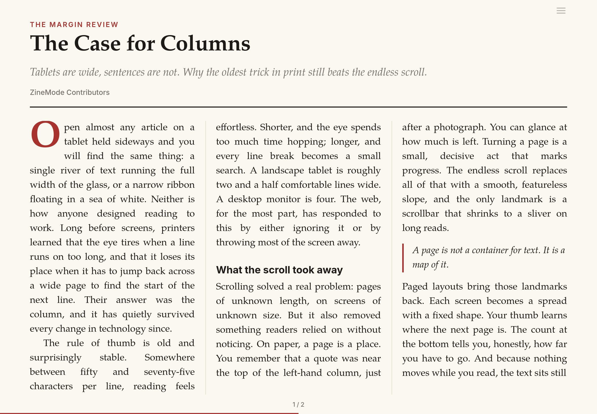

# ZineMode

Read web articles in paged, magazine-style columns.

ZineMode takes the article you're reading, pulls out the text with [Mozilla Readability](https://github.com/mozilla/readability), and sets it in multi-column spreads you page through sideways: headline across the top, drop cap, justified and hyphenated text, light/sepia/dark themes. It's built for Safari on iPad and Mac and works in other browsers. No app or browser extension of its own.

**Install:** <https://crazor.github.io/ZineMode/>



## Two ways to run it

- **Userscript** (recommended for Safari): install [`ZineMode.user.js`](https://crazor.github.io/ZineMode/ZineMode.user.js) with the free [Userscripts](https://github.com/quoid/userscripts) extension (also works with Tampermonkey and Violentmonkey). Adds a small button on article pages and opens straight into full screen. Updates via `@updateURL`.
- **Bookmarklet**: nothing to install. Drag it to the Favorites bar from the install page; it syncs to iPad through iCloud. Checks once a day for a newer version and shows a notice.

## Using it

- Turn pages: swipe, tap the outer thirds, arrow keys, space.
- ☰ (top right): text size, theme.
- Leave: exit full screen (Safari's ✕ or Esc). The original page comes back unchanged, at the same scroll position.
- Your reading position is remembered per article, and survives font size changes and rotation.
- Userscript: ⌥⇧Z opens ZineMode on any page. F toggles full screen.

## Development

```sh
npm install
npm test            # builds, then runs the WebKit end-to-end tests
npm run build:site  # assembles the GitHub Pages site into _site/
node scripts/screenshot.mjs   # regenerates the preview images
```

- `src/core.js`: extraction, layout, paging, menu, full screen, reading position.
- `src/bookmarklet.js`, `src/userscript.js`: the two entry points.
- `scripts/build.mjs`: bundles both with esbuild into `dist/`; `--site` also builds `_site/` from `site/`.
- `test/`: Playwright WebKit tests on synthetic fixture pages. When a site breaks, add a small fixture that reproduces its structure (not a copy of the article).

Pushing to `main` runs the tests and publishes the site via GitHub Actions. To release, bump `version` in `package.json`: the userscript's `@version` and the bookmarklet's update check both follow it.

### Notes on extraction

Readability's "is this page chrome?" heuristics match words like `header` or `hidden` anywhere in class names, which misfires on utility-CSS frameworks (e.g. Tailwind's `group/header-newsletter` made it drop TIME's whole article body). ZineMode strips class tokens containing `:`, `/` or `[` before extraction, retries with looser rules when the result is suspiciously short, removes in-article newsletter sign-ups, and prefers the page's own `<h1>` over a `Headline | Site` title.

## Credits

Article extraction by [Mozilla Readability](https://github.com/mozilla/readability), Apache License 2.0. The built bookmarklet and userscript include it.
